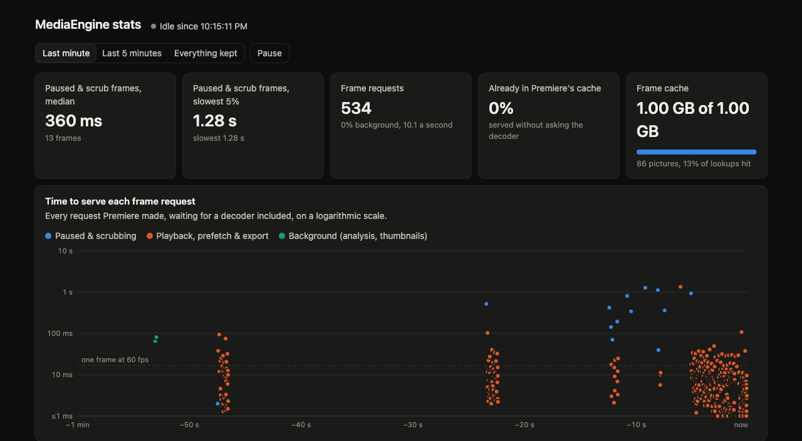

# Codecless

**AV1 and VP9 straight into Premiere Pro. No converting first.**

Premiere Pro doesn't import AV1 or VP9 video well, and most YouTube downloads (and a lot of
screen recordings and web video) use one of the two. So editors convert every clip to H.264 or
ProRes before they can start cutting, which costs time, disk space and quality. Codecless is a
native Premiere Pro importer plugin that opens AV1 and VP9 files (`.mp4`, `.mkv`, `.webm`)
directly. On Apple silicon it decodes them on the Mac's media engine through VideoToolbox, with
frame-accurate seeking and sample-accurate audio, and falls back to dav1d / FFmpeg software
decoding when the hardware can't decode a stream. Anything that isn't AV1 or VP9 is declined,
so Premiere's own importers keep handling H.264, ProRes and the rest.

> [!WARNING]
> **Alpha, in active development.** It works on the author's machines and is verified frame by
> frame against FFmpeg, but it hasn't had wide testing yet. Keep your original files, and please
> [report problems](#reporting-bugs).

Inside Premiere the plugin shows up as **MediaEngine importer** (its internal name).

## Status

**Works today**
- AV1 (8- and 10-bit) and VP9 (8- and 10-bit) video in MP4, MKV and WebM, including MP4s whose
  edit list hides pre-roll pictures
- Hardware decoding on the Apple silicon media engine (AV1 on M3 and later, VP9 on all M-series
  chips); software decoding with dav1d (AV1) or libavcodec when the hardware rejects a stream,
  e.g. AV1 on M1/M2
- Frame-accurate seeking: frames match FFmpeg's software decode bit for bit, and stills exported
  from Premiere are pixel-identical to it
- Audio that comes with the video (Opus, AAC, Vorbis, MP3, FLAC, AC-3, E-AC-3, ALAC, PCM),
  aligned to the first video frame
- Color: Rec. 601/709/2020, PQ and HLG are read from the stream and declared to Premiere's color
  management, so HDR10 clips import as Rec. 2100 PQ and tone-map correctly in SDR sequences
- Frames are handed to Premiere in the media engine's own NV12 / P010 layout with no conversion,
  plus a 1 GB frame cache and a separate decoder for Premiere's background analysis, so scrubbing
  keeps working while Premiere analyzes new clips
- A log of which decoder each clip uses, the decoder name in Premiere's Properties panel, and a
  live stats page with per-frame request timings
- `meprobe`, a command-line tool to inspect clips, benchmark decoding and hash frames

**Not yet / known limits**
- **macOS on Apple silicon only.** No Windows and no Intel Mac support.
- No signed or notarized release yet (builds are ad-hoc signed).
- Opening a clip reads the whole file once to index it, so very large files take longer to
  import and to reopen after Premiere releases them.
- Long-GOP sources (YouTube uses up to ~7 s between keyframes) make random seeks cost
  0.3–0.8 s on average and up to ~1.4 s at 4K. Scrubbing near the playhead and playback come
  from the frame cache.
- WebM/MKV audio can run up to ~12 ms longer than the video, padded with silence.
- HLG and the BGRA fallback path are implemented but haven't been tried on real footage yet.
- Premiere's own media analysis (Settings > Media Analysis & Transcription) competes for the
  media engine for a while after import. It runs once per file and its results are cached.
- Clips imported before installing (or with an older build) keep Premiere's cached
  interpretation. Re-import them, or override the color space in Interpret Footage.

## Requirements

- A Mac with Apple silicon (M1 or later) running macOS 13 Ventura or later
- Premiere Pro 2025 or later (tested on 26.5 and 27.0)
- On M3 and later, AV1 and VP9 both decode in hardware. On M1 and M2, VP9 is hardware and AV1
  is decoded in software (dav1d): it plays, but 4K AV1 scrubbing is slower.

## Install

1. Download the latest zip from [Releases](../../releases) and unzip it.
2. Quit Premiere Pro.
3. Right-click `Install.command` and choose **Open** (a plain double-click is blocked the first
   time, because the build isn't notarized by Apple). If macOS still refuses: System Settings >
   Privacy & Security > scroll down > **Open Anyway**.
4. Enter your Mac login password when Terminal asks. It copies the plugin into
   `/Library/Application Support/Adobe/Common/Plug-ins/7.0/MediaCore/MediaEngine`.
5. Start Premiere and import an AV1 or VP9 file.

To remove it, quit Premiere and open `Uninstall.command` the same way.

## Build from source

You need:

- Xcode command line tools: `xcode-select --install`
- The **Adobe Premiere Pro C++ SDK**. Adobe's license doesn't allow redistributing it, so it isn't
  in this repo. Download it from the [Adobe Developer Console](https://developer.adobe.com/console/servicesandapis/pr)
  (sign in with a free personal Adobe account; if it won't load, see Adobe's
  [access guide](https://developer.adobe.com/premiere-pro/access-the-developer-console/))
  and unzip it into `sdk/`, so the headers
  end up at `sdk/Premiere Pro 26.0 C++ SDK/Examples/Headers`. For a different SDK version or
  location, pass the headers folder: `make SDK="/path/to/Examples/Headers"`. `sdk/` is in
  `.gitignore`.

### Development build (links Homebrew FFmpeg)

```bash
brew install ffmpeg
```

```bash
make install
```

This builds `build/MediaEngine.bundle` and `build/meprobe` and copies the plugin into
`/Library/Application Support/Adobe/Common/Plug-ins/7.0/MediaCore/MediaEngine`. Restart Premiere
afterwards. This build links Homebrew's FFmpeg libraries, so run `make install` again after
`brew upgrade ffmpeg`.

### Self-contained build (to give to other Macs)

```bash
brew install meson ninja pkg-config
```

```bash
make package
```

The first run downloads and builds FFmpeg 9.0.2 and dav1d 1.5.4 as static LGPL / BSD libraries
(`tools/build-deps.sh`, about a minute and a half). The result, `dist/MediaEngine-Importer.zip`,
runs on Apple silicon with macOS 13 or later, needs no Homebrew, and contains `Install.command`,
`Uninstall.command`, a READ ME, the license and the third-party notices. It contains no Adobe SDK
files.

### Test

`tests/verify.sh` generates test clips (needs Homebrew `ffmpeg` with libvpx and SVT-AV1) and
checks frames fetched in random order against `ffmpeg -f framemd5`:

```bash
tests/verify.sh /tmp/codecless-verify
```

Pass your own clips after the work folder to check those instead. To benchmark a clip:

```bash
build/meprobe bench clip.webm
```

## Using it

- Import AV1 or VP9 files as usual. Select a clip and the Properties panel shows
  "MediaEngine importer" and which decoder it uses.
- Log: `~/Library/Logs/MediaEngine.log` (decoder per clip, and anything the plugin declined)
- Live stats: while Premiere is running, open the stats page to see how long each frame request
  took, what Premiere asked for it, and how the frame cache is doing:

```bash
open ~/Library/Logs/MediaEngine/stats.html
```



## Measured on M4 (macOS 27.2, Premiere Pro 26.5.2, FFmpeg 9.0.2)

| Clip | Decoder | Sequential | CPU |
|---|---|---|---|
| 4K AV1 10-bit | media engine | 326–392 fps | 6–8% of one core |
| 4K VP9 8-bit | media engine | 93–109 fps | 4–5% of one core |
| 720p AV1 / VP9 | media engine | 800–1045 fps | ≈10% of one core |

Real YouTube downloads (4K60 AV1 and VP9, 4K60 AV1 and VP9 HDR10, a 10-minute 1080p60 AV1 MKV)
match FFmpeg frame for frame on every sampled frame. Exported audio is sample-aligned and
matches to 24-bit precision.

## How it works

- `src/importer.cpp`, `src/importer.r`, `Info.plist`: the Premiere importer plugin
- `src/video_decoder.*`: demux index, media-engine decode, keyframe seeking, shared frame cache
- `src/audio_decoder.*`: planar float audio aligned to video frame 0, exact seeks on
  millisecond-timestamp containers
- `src/stats.*`: per-request timings for the stats page
- `tools/meprobe.cpp`: inspect, benchmark and hash frames from the command line
- `tools/stats.html`: the stats page, installed to `~/Library/Logs/MediaEngine/`
- `tools/build-deps.sh`, `tools/package/`: static FFmpeg + dav1d and the installer scripts
- `tests/verify.sh`: frame-hash checks against FFmpeg

Each clip gets two decoders. Requests that follow the playhead (scrubbing, playback, prefetch,
export) use one. Premiere's own bookkeeping (media analysis, thumbnails, requests without an
intent) uses the other, which reuses the first one's index instead of reading the file again.
Premiere analyzes every imported clip; on a 7.5-minute 4K60 YouTube download that is about 2,400
frame requests over 20 minutes, and with a single decoder scrubbing during that time showed no
new frame until the drag ended.

## Reporting bugs

[Open an issue](../../issues/new/choose) with the bug report form. It asks for your Premiere
version, macOS version and Mac model, the codec and container, and steps to reproduce. Please
attach the relevant lines from `~/Library/Logs/MediaEngine.log`. If you can share a short sample
clip (or say where it came from), that helps most.

## Related

- [MediaDrop](https://github.com/robinxprince/MediaDrop), by the same author.

## License

[MIT](LICENSE) © 2026 robinxprince.

Builds made with `make package` include FFmpeg (LGPL-2.1-or-later) and dav1d (BSD 2-Clause);
see [THIRD_PARTY_NOTICES.txt](THIRD_PARTY_NOTICES.txt). The Adobe Premiere Pro SDK is Adobe's
and is not included. Premiere Pro is a trademark of Adobe; this project isn't affiliated with or
endorsed by Adobe.
